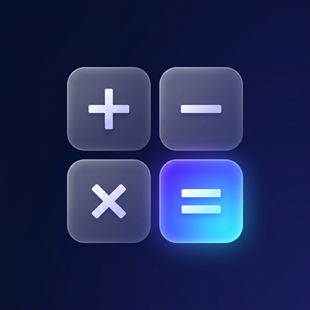
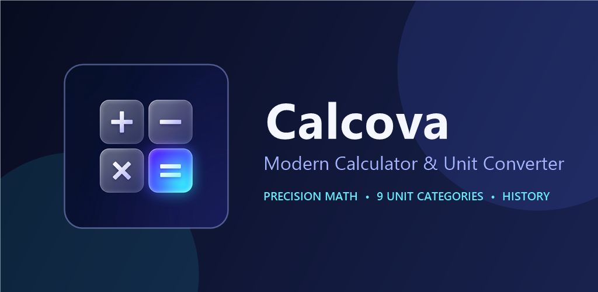

# Calcova Calculator



**Calcova Calculator** (`com.mosamircs.calcova`) is a modern Android calculator and unit converter built with Kotlin, Material 3, and Jetpack Compose in a sleek **Midnight Indigo** design.



## Features

- **Precision Calculator:** Supports arithmetic, percentages, powers, square roots, negative toggling, and localized number formatting powered by EvalEx (`BigDecimal`).
- **9-Category Unit Converter:** Length, Area, Volume, Mass, Temperature, Time, Speed, Pressure, and Energy with instant bidirectional unit swapping.
- **Calculation History:** Persistent Room database storing past formulas and results for quick reuse.
- **Midnight Indigo & Daylight Minimal Themes:** Dark-first glassmorphic design with an optional Daylight Minimal light theme and system theme support.
- **Home-Screen Widget:** Resizable calculator widget with customizable colors.
- **AdMob & UMP Consent:** Integrated Google Mobile Ads SDK (Adaptive Banner + frequency-capped Interstitial) with Google User Messaging Platform (UMP) consent management.

## Building Releases

```powershell
$env:JAVA_HOME="C:\Android\jdk\jdk-17.0.21+9"
$env:ANDROID_HOME="C:\Android\Sdk"
.\gradlew.bat bundleGplayRelease assembleGplayRelease
```

Release signing reads `keystore.properties` (excluded from git).

## License

Licensed under the **GNU General Public License v3.0** (see [LICENSE](LICENSE)). Based on the open-source Fossify Calculator codebase.
